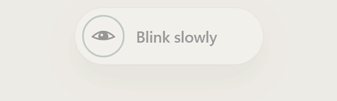
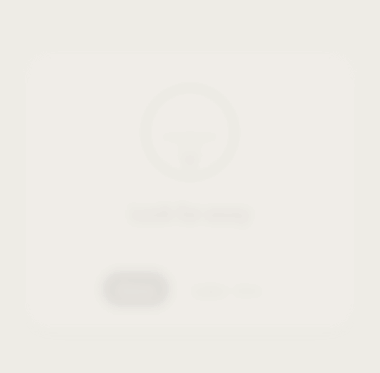
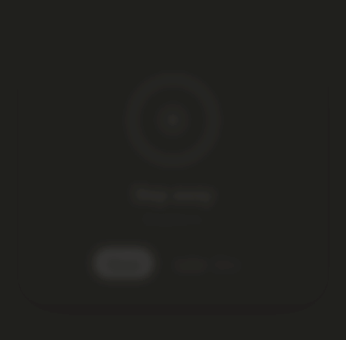
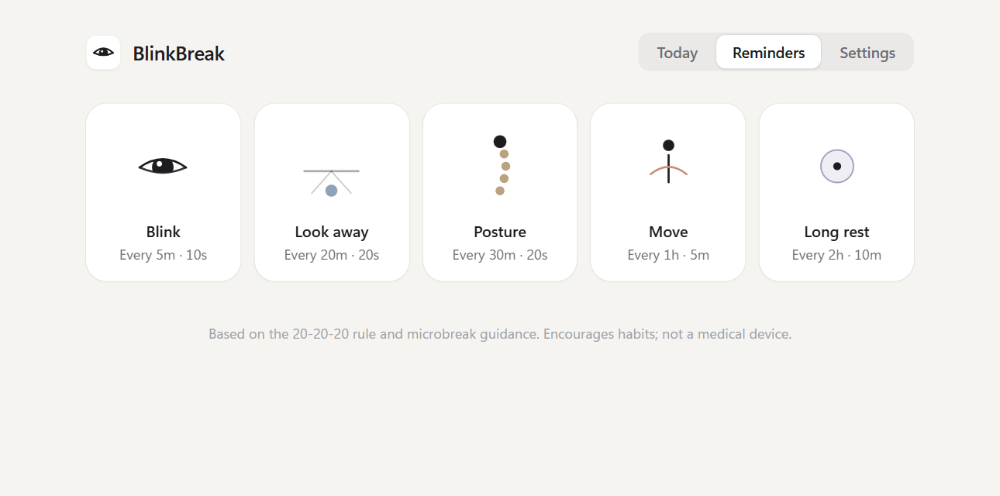
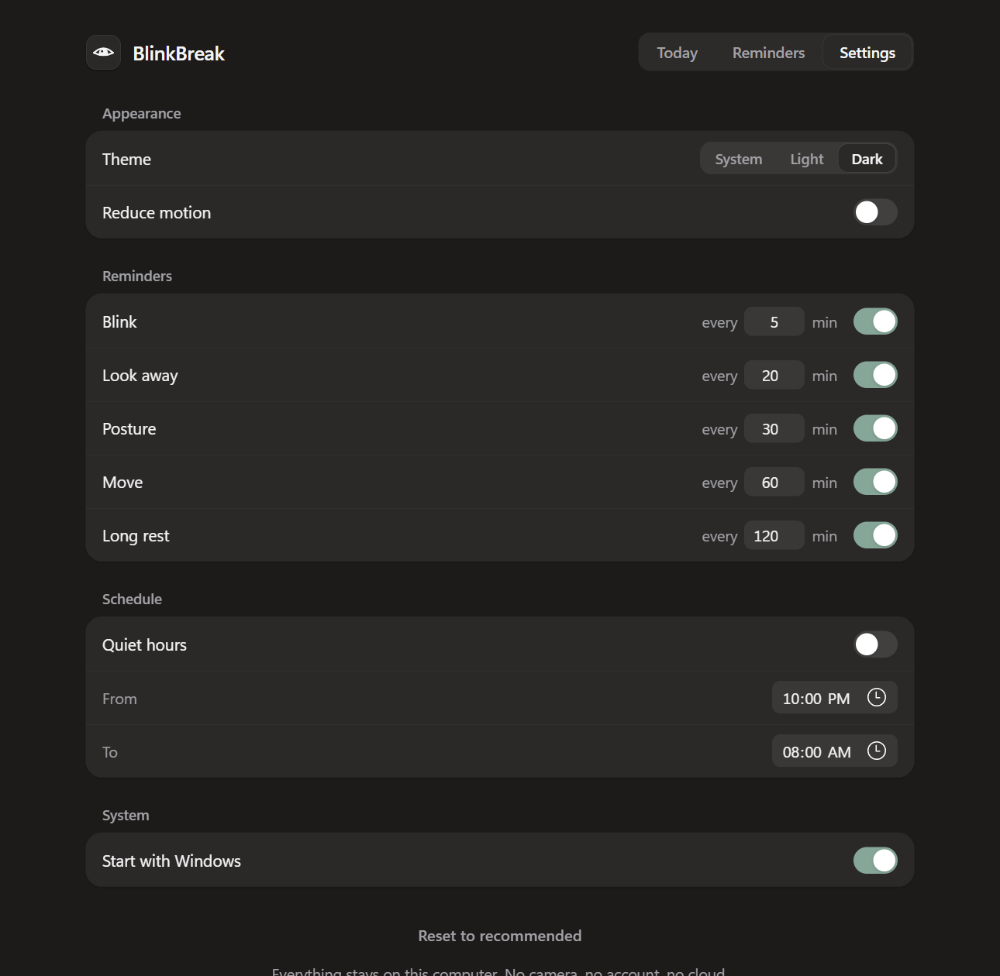

<div align="center">

# BlinkBreak

**Calm reminders to blink, look away, and move.**<br>
A small, private desktop app for long screen sessions. Windows, macOS, and Linux builds share the same calm UI.

[](https://github.com/rinshidvp/blinkbreak/releases/latest)

[](https://github.com/rinshidvp/blinkbreak/releases/latest)
[](https://github.com/rinshidvp/blinkbreak/actions/workflows/build-desktop.yml)




</div>

## Download

Free, about a minute to install. Click the file for your computer:

| Your computer | Download |
|---|---|
| **Windows** 10 / 11 | [**BlinkBreak-Windows-Setup.exe**](https://github.com/rinshidvp/blinkbreak/releases/latest/download/BlinkBreak-Windows-Setup.exe) |
| **Mac** with M1, M2, M3, M4… chip | [**BlinkBreak-Mac-AppleSilicon.dmg**](https://github.com/rinshidvp/blinkbreak/releases/latest/download/BlinkBreak-Mac-AppleSilicon.dmg) |
| **Mac** with Intel processor | [**BlinkBreak-Mac-Intel.dmg**](https://github.com/rinshidvp/blinkbreak/releases/latest/download/BlinkBreak-Mac-Intel.dmg) |
| **Linux**: Ubuntu / Debian | [**BlinkBreak-Linux.deb**](https://github.com/rinshidvp/blinkbreak/releases/latest/download/BlinkBreak-Linux.deb) |
| **Linux**: any other distribution | [**BlinkBreak-Linux.AppImage**](https://github.com/rinshidvp/blinkbreak/releases/latest/download/BlinkBreak-Linux.AppImage) |

Not sure which Mac? **Apple menu → About This Mac**: "Chip: Apple M…" means Apple Silicon.
Then follow the **[step-by-step install guide](docs/INSTALL.md)**. All versions and checksums are on the
[releases page](https://github.com/rinshidvp/blinkbreak/releases).

## Why BlinkBreak?

- **Private.** No internet, no account, no tracking. Nothing leaves your computer.
- **Quiet.** Reminders are designed not to take keyboard focus. Fullscreen deferral is currently supported on Windows.
- **Strict when you want it.** Turn on **Strict mode** and breaks show even over fullscreen videos, games, and presentations.
- **Brief.** Every reminder leaves on its own when its time is up.

## Reminders

Each reminder is a small symbol whose motion *is* the exercise. It is timed to
fit the reminder exactly, and a thin ring shows the time left.

<p align="center">
  
  &nbsp;&nbsp;
  
</p>

| Reminder | Every (active use) | For | Motion |
|---|---|---|---|
| Blink | 5 min | 10 s | an eye lowers its lid, rests, and lifts: four slow blinks |
| Look away | 20 min | 20 s | a dot drifts out to the horizon (the 20-20-20 rule) |
| Posture | 30 min | 20 s | a curved column of dots eases upright |
| Move | 60 min | 5 min | arms lift in one slow arc |
| Long rest | 2 h | 10 min | a circle breathes: in for 4 s, out for 6 s |

Windows and macOS timers count **active use only**, so they pause when you step away.
Linux uses GNOME/Mutter or freedesktop ScreenSaver idle data when available; otherwise timers count while the app is open.
**Done** records the break, **Later** snoozes it (the length is shown), and clicking
anywhere outside the card dismisses it. When time runs out, blink and look-away
count as done, because following the countdown *is* the exercise.

## Light and dark

BlinkBreak follows your system appearance by default. Choose **Settings → Appearance → Light** or **Dark** to set it yourself.

<p align="center">
  
  
</p>

## Gentle sounds

In **Settings → Sound**, optionally enable a soft cue when a break begins. Choose
**Soft bell**, **Wooden tap**, or **Airy tone**, adjust the volume, and use **Start**
and **End** to preview both cues—even while automatic sounds are off. **Blink**
previews the brief, clear single-note cue used when a blink reminder appears.

The optional **End-of-break cue** tells you when the countdown ends, so you can
look away without watching the timer. Done, Later, and dismissing a break do not
play this cue. Blink reminders have a short start cue only, never an end sound. Sound is off by default, works
offline, and follows the existing reminder schedule and quiet hours.

## Install

**New to this?** Follow the [step-by-step install guide](docs/INSTALL.md). It takes about a minute.

1. **[Download](#download)** the file for your computer.
2. Install it:
   - **Windows:** open the `.exe`. No admin rights needed; it installs just for you.
   - **Mac:** open the `.dmg` and drag BlinkBreak to Applications. The first open needs one
     approval in **System Settings → Privacy & Security → Open Anyway** (see the FAQ).
   - **Linux:** `sudo apt install ./BlinkBreak-Linux.deb`, or `chmod +x BlinkBreak-Linux.AppImage` and run it.
3. BlinkBreak keeps running in your **system tray / menu bar**.
   Click the icon for **Open dashboard**, **Take a break now**, **Pause 15 min**, and **Quit BlinkBreak**.
4. It starts by itself when you sign in. Change that in **Settings → Start at login**.

Fullscreen deferral is currently Windows-only; Linux idle sensing depends on the desktop session (see the FAQ).

## FAQ

<details>
<summary><b>Windows says "Windows protected your PC". Is it safe?</b></summary>

The installer isn't code-signed yet (signing certificates cost money), so
SmartScreen doesn't recognise it. Click **More info → Run anyway**. Each
release lists a SHA-256 checksum you can compare with
`Get-FileHash .\BlinkBreak-Windows-Setup.exe`. Or build it yourself from
source; the code is short enough to read.
</details>

<details>
<summary><b>macOS says it can't verify BlinkBreak. How do I open it?</b></summary>

The Mac app isn't notarized by Apple yet (that needs a paid Apple developer
account). The first time you open it, click **Done**, then open
**System Settings → Privacy & Security** and click **Open Anyway** next to
BlinkBreak. macOS remembers this, so you only do it once. Compare the
download with the release's SHA-256 checksum (`shasum -a 256 BlinkBreak-Mac-AppleSilicon.dmg`)
if you want to be sure it's the real file.

If macOS says the app **"is damaged and can't be opened"**, run
`xattr -dr com.apple.quarantine /Applications/BlinkBreak.app` in Terminal once.
</details>

<details>
<summary><b>Will it interrupt my game, movie, or presentation?</b></summary>

Not by default. On Windows, if a fullscreen app is in front, reminders wait until you leave
fullscreen. On macOS and Linux they don't cover fullscreen apps.
Reminders are designed not to take keyboard focus, so your typing keeps going where it was.

Want breaks to interrupt anyway? Turn on **Settings → Fullscreen → Strict mode**. Breaks then
show even over fullscreen videos, games, and presentations, and you can still close them. This
works on Windows, macOS, and Linux X11 desktops (such as GNOME on Xorg). Wayland desktops don't
let apps appear above fullscreen windows, and Settings tells you when that applies. Games that
take over the screen in exclusive fullscreen can still hide a break. On macOS, BlinkBreak's Dock
icon steps aside while a strict break is showing, because macOS only lets menu-bar apps cover
fullscreen apps.
</details>

<details>
<summary><b>Can I start a break with a keyboard shortcut?</b></summary>

Yes. While BlinkBreak is running, run it again with `--break-now` and it starts a break right
away, even over a fullscreen app. Bind that command to a shortcut in your system's keyboard settings:

- Windows: `"%LOCALAPPDATA%\BlinkBreak\blinkbreak.exe" --break-now`
- macOS: `/Applications/BlinkBreak.app/Contents/MacOS/blinkbreak --break-now`
- Linux (`.deb`): `blinkbreak --break-now`
</details>

<details>
<summary><b>How do I pause it or turn a reminder off?</b></summary>

Tray icon → **Pause 15 min**, or open the dashboard for **Pause 1h**. In
**Settings** you can switch each reminder on/off, change how often it
appears, set quiet hours, and pick light or dark.
</details>

<details>
<summary><b>Does it start at login?</b></summary>

Yes. A new install starts at login by default, quietly in the tray / menu bar.
Turn it off or on any time in **Settings → Start at login**.
</details>

<details>
<summary><b>How do I uninstall it?</b></summary>

First turn off **Settings → Start at login** and quit BlinkBreak from the tray / menu bar icon. Then:
Windows **Settings → Apps → Installed apps → BlinkBreak → Uninstall**.
On macOS drag BlinkBreak from Applications to the Trash; on Linux remove the `.deb` (`sudo apt remove blink-break`)
or delete the `.AppImage`.
</details>

<details>
<summary><b>What data does it collect?</b></summary>

None. The only thing it reads from your OS is how many seconds since your last
keyboard/mouse input (to know whether you're active). Idle sensing is supported on Windows
and macOS. On Linux it uses Mutter or freedesktop ScreenSaver D-Bus where available;
otherwise the app says so in Settings.
Settings and daily stats stay on your machine.
</details>

<details>
<summary><b>Mac or Linux limitations?</b></summary>

Both install and remind normally. Idle sensing is supported on macOS and on Linux sessions
that expose the relevant D-Bus service. System-wide fullscreen detection is only implemented
on Windows; on Linux without a supported idle service, timers count while the app is open.
Further native sensing improvements are tracked in
[issue #5](https://github.com/rinshidvp/blinkbreak/issues/5).
</details>

## Health basis

Based on the AOA 20-20-20 rule, AAO guidance on blinking and distance breaks,
and OSHA microbreak and posture guidance. BlinkBreak encourages healthy
habits; it is not a medical device.

## Build from source

Frontend only (browser demo with a simulated activity clock, no Rust needed):

```powershell
npm install
npm test        # unit + component tests
npm run lint    # TypeScript check
npm run dev     # browser demo at http://localhost:1420
```

Desktop app (needs [Rust](https://rustup.rs) stable; Windows also needs MSVC + Visual Studio C++ build tools):

```powershell
npm run tauri dev     # run the desktop app with hot reload
npm run tauri build   # Windows -> src-tauri/target/release/bundle/nsis/BlinkBreak_*_setup.exe
```

Linux needs WebKitGTK system packages first (Debian/Ubuntu):

```bash
sudo apt install libwebkit2gtk-4.1-dev build-essential curl wget file libxdo-dev libssl-dev libayatana-appindicator3-dev librsvg2-dev
npm run tauri build -- --bundles deb,appimage
```

macOS:

```bash
npm run tauri build -- --bundles dmg
```

> Only one BlinkBreak can run at a time. Quit the installed copy from the tray
> before `npm run tauri dev`, or the dev build will hand over to it and exit.

Built with [Tauri 2](https://tauri.app), React, TypeScript, and Rust.

## Contributing

Ideas, bug reports, designs, and PRs are all welcome. Good places to start are
issues labelled
[`good first issue`](https://github.com/rinshidvp/blinkbreak/labels/good%20first%20issue).
See [CONTRIBUTING.md](CONTRIBUTING.md) and the
[Code of Conduct](CODE_OF_CONDUCT.md). Questions →
[Discussions](https://github.com/rinshidvp/blinkbreak/discussions).
Security reports → [SECURITY.md](SECURITY.md). What's changed →
[CHANGELOG.md](CHANGELOG.md).

## License

MIT. See [LICENSE](LICENSE).
